> [!IMPORTANT]
> 免責事項：SmartGitUPMはオープンソースのサービスであり、Unity Technologies Inc.が提供する公式のサービスではありません。

# SmartGitUPM
Unity Editorで、Gitリポジトリ内のパッケージを効率的に管理するためのプラグイン。

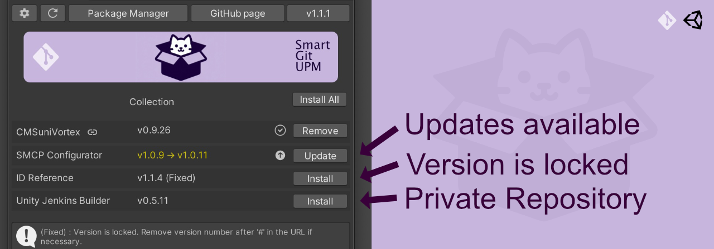

## このプラグインを利用する理由

### アップデートを一目で確認

Unity Package Managerは、Gitで公開されているパッケージのアップデート情報を知る事ができません。
`SmartGitUPM`なら分かりやすいUIで確認できます。

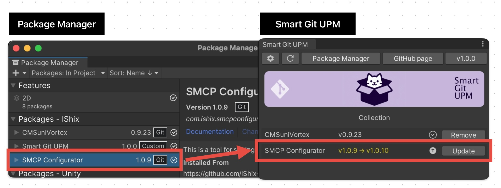

### プライベートリポジトリの更新確認に対応

プライベートリポジトリ(SSH接続)のパッケージに対応。更新確認がプライベートリポジトリでも可能です。

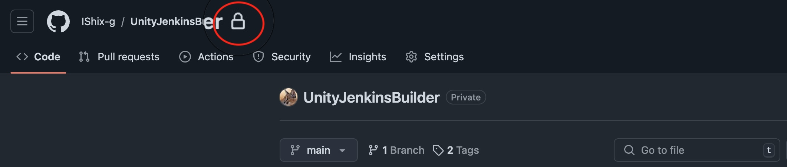

- SSHを設定し、SSH用のURLを指定。例) `git@github.com:IShix-g/SmartGitUPM.git`
- 大きなプライベートリポジトリは、初回の表示に時間がかかります。
- パブリックリポジトリに大小は関係なく、表示速度は変わりません。

### 更新通知

Unity Editorを開く度に、パッケージの更新があれば通知を受け取る事ができます。(通知の停止可)

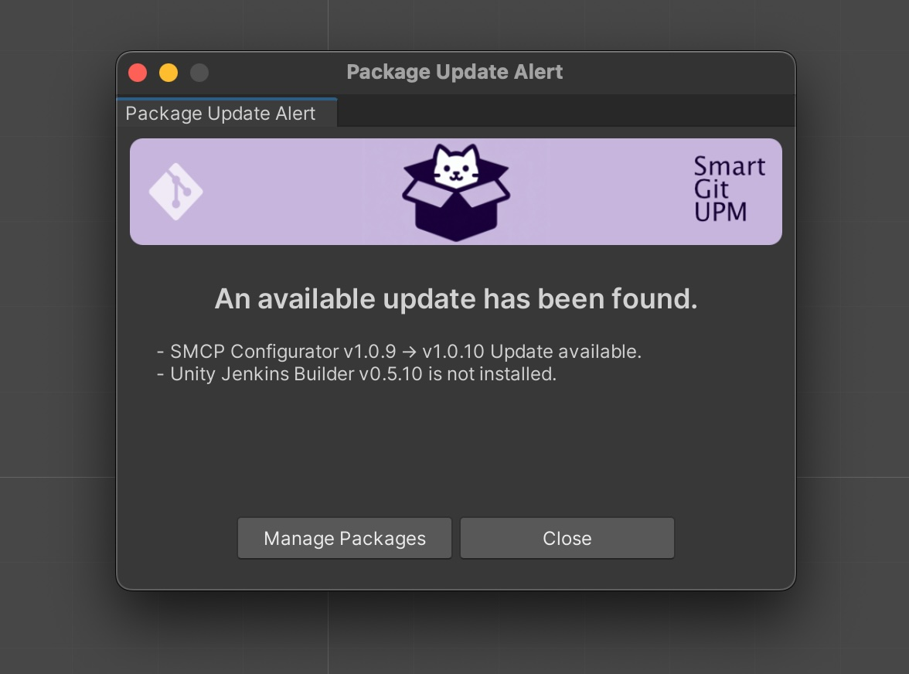

### 内部ではUPMを利用しているので安心

内部では、Unity Package Manager(UPM)を利用しパッケージ管理をしているので安心。
もし、`SmartGitUPM`が気に入らなくなっても削除すればおしまいです。以降は、UPMで通常通り管理できます。

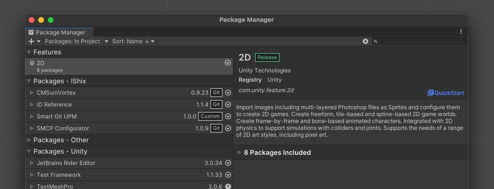

## Getting Started

### Git Urlからインストール

"Unity Editor : Window > Package Manager > Add package from git URL...".

```
https://github.com/IShix-g/SmartGitUPM.git?path=Packages/SmartGitUPM#v1
```

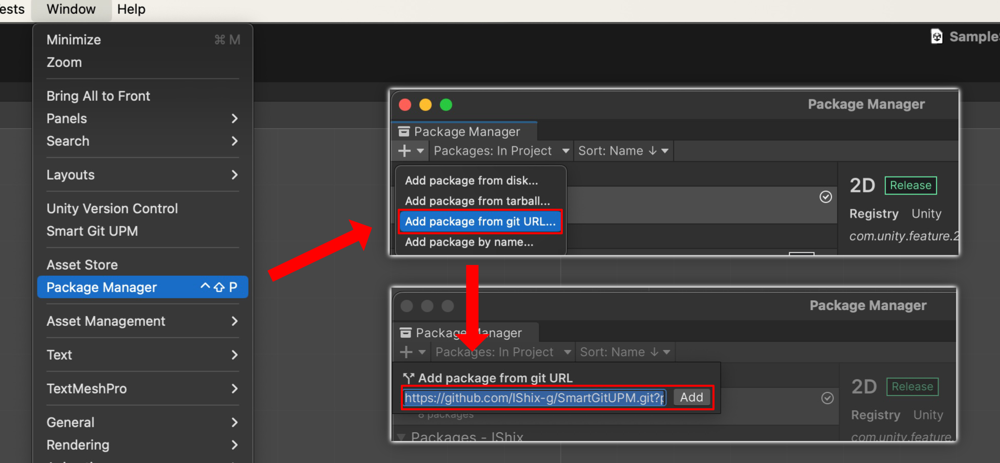

### SmartGitUPMを開く

`Unity Editor : Window > Smart Git UPM`

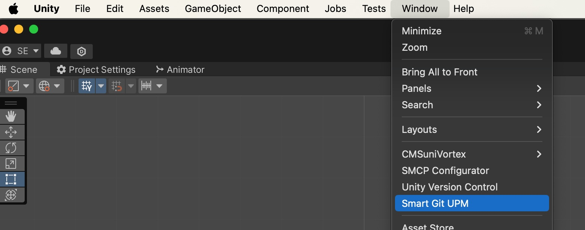

### 設定を開く

歯車ボタン、もしくは未設定時のみ表示される設定ボタンをクリック

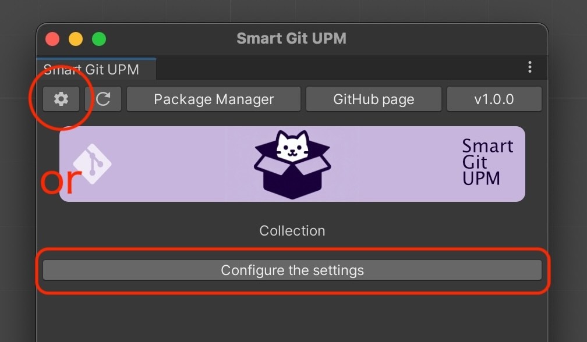

### パッケージを設定

| フィールド                    | 説明                              | 例                                                                                                                                                           |
|--------------------------|---------------------------------|-------------------------------------------------------------------------------------------------------------------------------------------------------------|
| Update Notify            | Unity Editor起動時にアップデートの通知を受けるか？ | [チェックした場合] アップデートを受け取る                                                                                                                                      |
| Install Url              | パッケージのインストールURL (https or SSH)  | [https] https://github.com/IShix-g/CMSuniVortex.git?path=Packages/CMSuniVortex<br/>[SSH] git@github.com:IShix-g/CMSuniVortex.git?path=Packages/CMSuniVortex |
| Branch (Optional)        | 必要あればブランチ名を指定                   | 空欄 または `main` や `master` など                                                                                                                                 |
| Help Page Url (Optional) | 必要あればヘルプページを指定                  | 空欄 または ヘルプページのURL https://github.com/IShix-g/CMSuniVortex など                                                                                                |

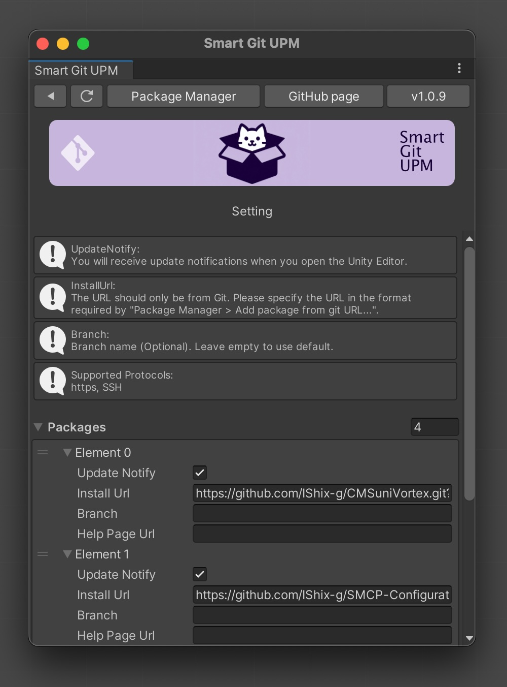

### リロード

設定後、リロードボタンをクリックして完了です。
次回からは、下記タイミングでリロード処理が実行されます。

- Unity Editorを起動した時
- Smart Git UPMを表示した時

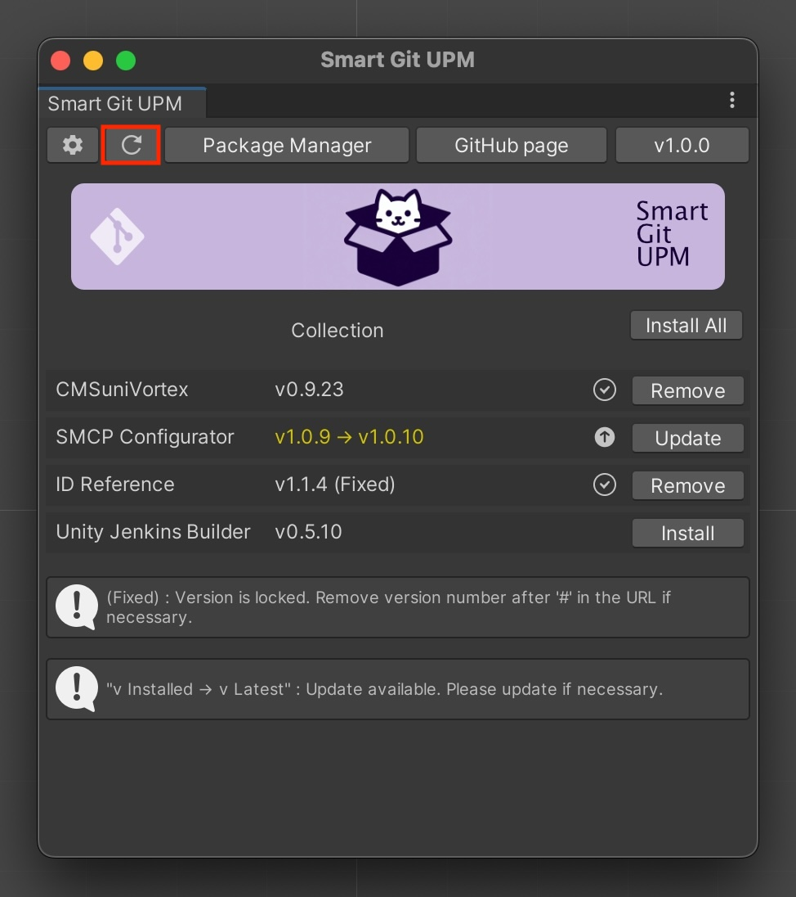

### プラグインの言語

設定から言語が選択できます。アラートや注意文などが指定した言語に翻訳されます。

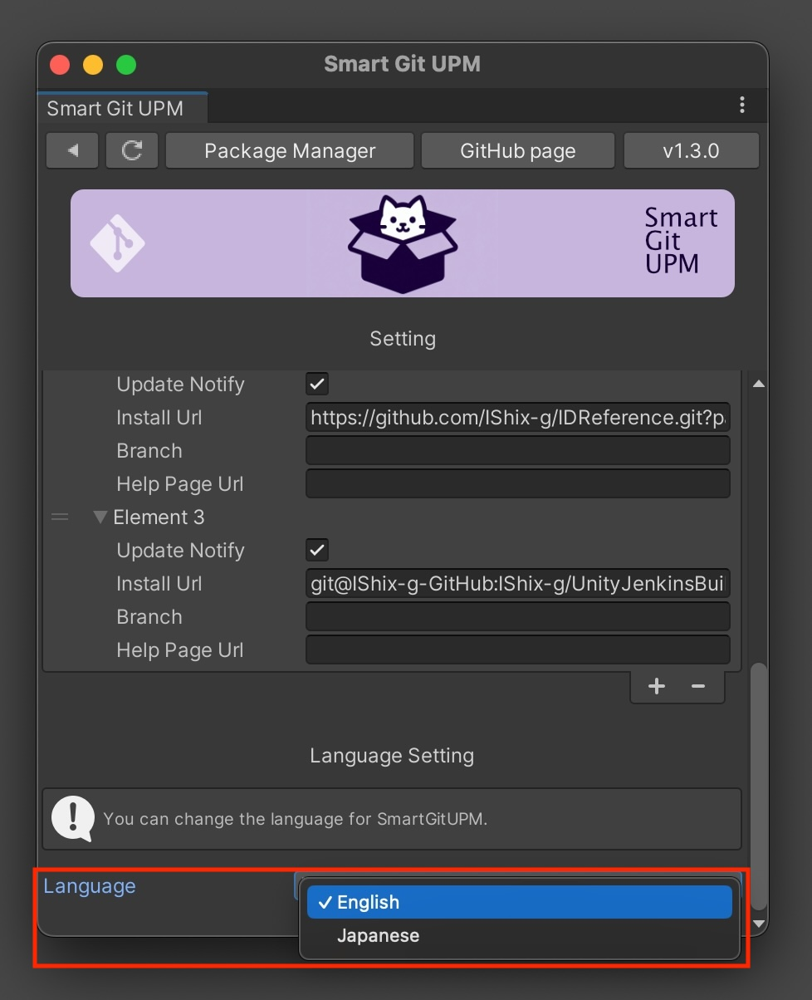

## 各ボタンの説明

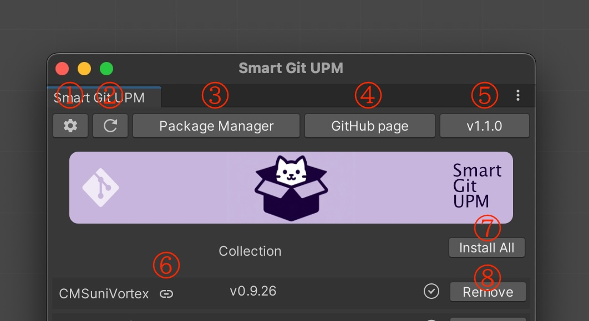

1. パッケージの設定を表示
2. パッケージのアップデート情報を再取得
3. Unity Package Managerを開く
4. Smart Git UPMのGitHubページを開く
5. Smart Git UPMのバージョン、クリックで最新バージョンの確認します。
6. ヘルプページの表示
7. すべてのパッケージのインストールまたはアップデート
8. パッケージ固有のボタン、下記のような状態があります。

| ボタン名 | ボタンのクリック       | パッケージの状態      |
|------|----------------|---------------|
| Install | パッケージをインストールする | 未インストール       |
| Update  | パッケージを更新する           | インストール済み、更新あり |
| Remove  | パッケージを削除する           | 最新版のインストール済み  |

## 現在のパッケージの状態表示

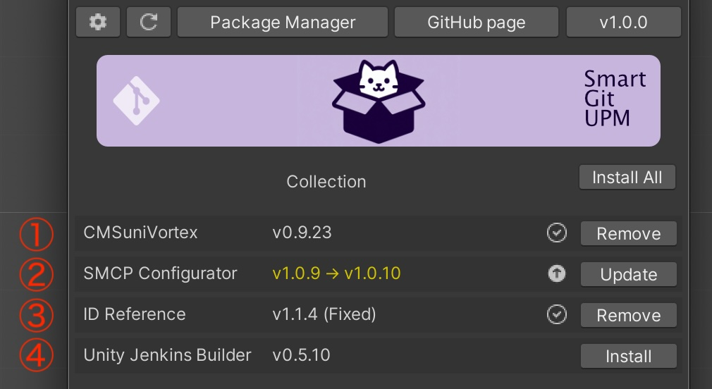

1. 最新バージョンのインストール済み
2. インストール済み、且つ更新可能な新バージョンあり v1.0.9 (現在) -> v1.0.10 (新)
3. インストール済み、且つバージョンの固定、URLの最後に`#1.1.4`などのバージョンを指定する事で固定可
4. 未インストール

## Editor API

Editorコードから `SmartGitUPM.Editor.SmartGitUPMApi` を利用できます。Assembly Definitionを使う場合は `SmartGitUPM.Editor` を参照し、対象PlatformをEditorのみにしてください。Editorのメインスレッドから、各操作を順番にawaitします。APIはWindow・Dialog・ProgressBarを表示しません。

既存の設定読込処理に従い、確認用の2操作を含むすべてのAPIは、設定assetが無ければ `Assets/Editor/SmartGitUPM_PackageCollectionSetting.asset` を作成します。

```csharp
using System.Threading;
using System.Threading.Tasks;
using SmartGitUPM.Editor;

public static class PackageAutomation
{
    public static async Task RunAsync(CancellationToken token = default)
    {
        bool hasMissing = await SmartGitUPMApi.HasUninstalledPackagesAsync(token);
        bool hasUpdates = await SmartGitUPMApi.HasUpdatesAsync(token);

        // Smart Git UPMに登録した完全なInstall URLを、#revisionを含めて指定します。
        await SmartGitUPMApi.UpdatePackageAsync(
            "https://github.com/IShix-g/CMSuniVortex.git?path=Packages/CMSuniVortex", token);
        await SmartGitUPMApi.InstallAllAsync(token);
    }
}
```

確認対象は、更新通知を無効にしたものも含む登録パッケージ全件です。更新確認は最新のリモート情報を取得し、インストール済みパッケージの更新有無を返します。バージョン固定時は設定された指定版との差を確認します。未インストール確認に必要なのはUPMの導入済み一覧だけです。登録が0件なら両確認は `false`、Install AllはUPMリクエストを行わず正常終了します。

`UpdatePackageAsync` はrevisionを含む登録URLをそのまま使い、未インストールの登録も導入できます。選択した登録だけを確認するため、無関係な未入力の登録はこの操作を妨げません。空値・未登録URLは `ArgumentException`、全体操作での不正な登録や情報取得・UPMの失敗はTask失敗、キャンセルは `OperationCanceledException` になります。キャンセルで待機を停止しても、送信済みのUPM操作は完了する場合があります。操作の完了と実際のパッケージ状態を確認してから、次の操作を開始してください。

### Unity Pipelineからの呼び出し

API自体はUnity Pipelineに依存しません。次の接続・コマンド探索例は、接続済みEditorに対しては未検証です。互換性のある `com.unity.pipeline` と接続済みEditorが用意されたProjectで対象を明示し、その版のヘルプとコマンド一覧で実際の呼び出しを確定してください。

```sh
unity status --project-path /absolute/path/to/project --json
unity command --project-path /absolute/path/to/project --query eval
```

接続先の版が提供するC#評価コマンドから、上記4操作をawaitします。コマンド名・非同期評価構文はPipelineの版によって異なるため、利用する版のコマンドヘルプで確認してください。EditorはBackgroundのままにし、Smart Git UPMのWindowは開きません。戻り値、Task完了、エラーと、操作後のUPMパッケージ状態を確認してください。

現行の[Pipeline動作要件](https://docs.unity.com/en-us/unity-cli/unity-pipeline/unity-pipeline-package)はUnity 6.0以降です。このリポジトリのサンプルProjectはUnity 2022.3のため、Pipeline検証には本パッケージとテスト用登録を持つ互換性のあるUnity 6検証Projectが必要です。既存利用ProjectのUnity更新やPipeline導入はAPIの利用条件ではありません。このサンプルProjectではPipeline経由の実行は未確認です。

## UPMとの役割分担

SmartGitUPMは、Unity Package Manager(UPM)が行わないGitのバージョン情報を視覚化したり、更新の通知をするプラグインです。
実際のインストールやアンストールは、Unity Package Managerに依頼します。

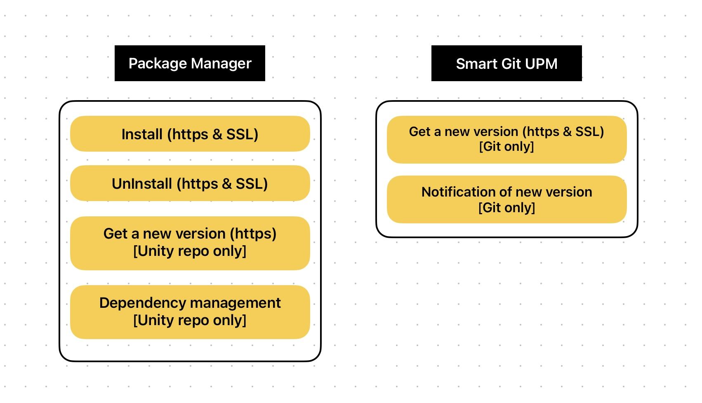

## OpenUPMとの違い

### OpenUPM
OpenUPMはオープンソースパッケージのレジストリです。登録されたパッケージをUnity Package Managerを通じて管理できます。パブリックに公開されたオープンソースパッケージを対象としています。

### SmartGitUPM
SmartGitUPMは登録の必要がなく、ユーザーが自身で必要なパッケージを管理します。パブリック、プライベートのパッケージを問わず、独自のインターフェース（UI）で柔軟に管理することが可能です。

_※ ロゴがほぼ一緒ですが、狙った訳ではありません。**「パッケージ = ダンボール = ねこ」** ダンボールが大好きな猫がダンボールで遊んでいるロゴにしようと作ったら、同じようなロゴになってしまいました。可愛すぎて変更したくなかったのでしばらくこのままでいかせてください。すみません。_

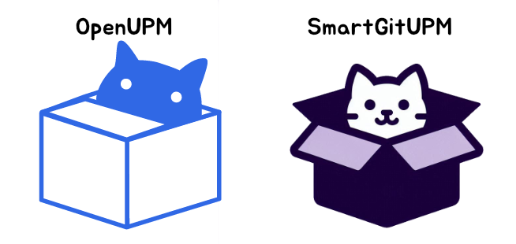
